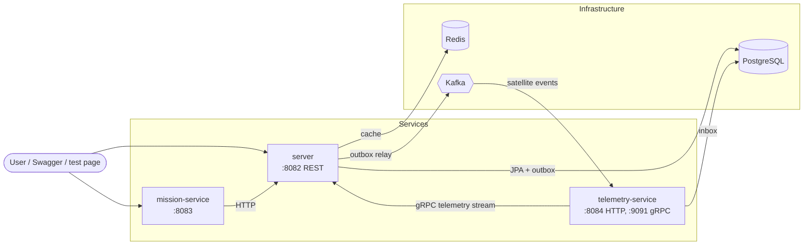
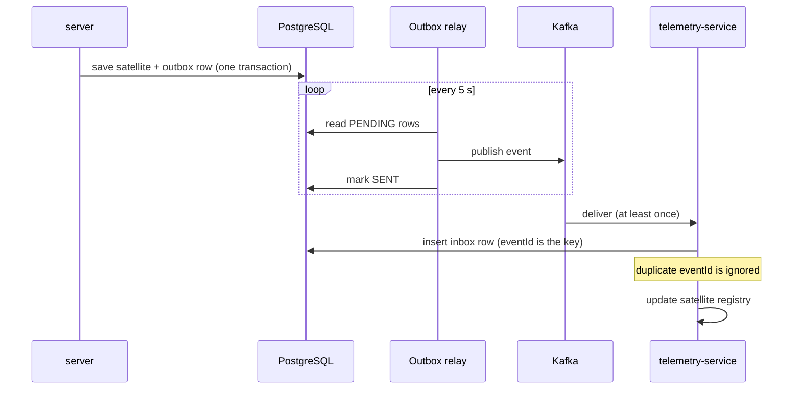

# 🛰️ Satellite Manager


A mission-control backend for satellite constellations: create constellations, add communication and imaging
satellites, run missions, receive live telemetry and keep other services informed about every change.

The project was built **step by step during a Java backend course**, from a small console program to a set of
Spring Boot microservices. Every seminar lives in its own branch; the full learning path is described in
**[SEMINARS.md](SEMINARS.md)**.

---

## Contents

- [Highlights](#highlights)
- [Architecture](#architecture)
- [Quick start](#quick-start)
- [Services and ports](#services-and-ports)
- [API](#api)
- [How it works](#how-it-works)
- [Tech stack](#tech-stack)
- [Project structure](#project-structure)
- [Testing](#testing)
- [Security and load testing](#security-and-load-testing)
- [Documentation](#documentation)
- [Known limitations](#known-limitations)

---

## Highlights

- **Five Gradle modules**: three Spring Boot services and two shared contract modules.
- **REST API** with Swagger UI, JPA entities with inheritance, **Flyway** migrations on **PostgreSQL**.
- **gRPC server streaming** for live satellite telemetry.
- **Kafka events** with the **Transactional Outbox** on the producer side and an idempotent **Inbox** on the consumer side.
- **Redis read cache** with per-cache TTLs and graceful degradation when Redis is down.
- **GoF patterns** in the domain: Builder, Factory Method, Strategy-style factory selection, Facade; **AOP** timing aspect.
- **Docker Compose** for the whole system, multi-stage images running as a non-root user, health checks.
- **Quality**: unit, mock and JPA tests with JaCoCo, k6 load tests with Allure, a DevSecOps audit
  (Gitleaks, Semgrep, SBOM, Grype, OWASP ZAP).

---

## Architecture



| Module | Role |
|--------|------|
| `server` | Mission control center: REST API, domain logic, JPA, Flyway, Redis cache, outbox relay to Kafka, gRPC telemetry client |
| `mission-service` | Gateway service that calls `server` over HTTP (`SERVER_URL`) |
| `telemetry-service` | Kafka consumer with an inbox, keeps a registry of known satellites, streams telemetry over gRPC |
| `telemetry-proto` | Shared Protocol Buffers contract (`StreamTelemetry`) |
| `satellite-events` | Shared Kafka event model (`SatelliteLifecycleEvent`) and topic names |

---

## Quick start

Requirements: **Docker** with Compose v2.

```bash
git clone https://github.com/KardashHleb/satellite-manager.git
cd satellite-manager
docker compose up --build
```

Compose starts PostgreSQL, Redis, Kafka and the three services in the `space-net` network, in the right order
(every service waits for the health checks of its dependencies). Demo data ("RU Basic" constellation) is created on startup.

Open:

- Swagger UI: http://localhost:8082/swagger-ui/index.html
- Test page: http://localhost:8082/test.html
- Health: http://localhost:8082/actuator/health (also on 8083 and 8084)

### Without Docker

Requirements: **JDK 21**, plus PostgreSQL, Kafka and Redis on their default ports (see
[docs/AdditionalREADME/README-DOCKER.md](docs/AdditionalREADME/README-DOCKER.md), in Russian).

```bash
./gradlew :server:bootRun
./gradlew :mission-service:bootRun
./gradlew :telemetry-service:bootRun
```

---

## Services and ports

| Service | Port | What to open |
|---------|------|--------------|
| `server` | 8082 | Swagger UI, `/api/**`, `/actuator/health`, `/actuator/caches`, `/actuator/metrics` |
| `mission-service` | 8083 | `/api/remote/overview`, `/actuator/health` |
| `telemetry-service` | 8084 (HTTP), 9091 (gRPC) | `/api/telemetry/known-satellites`, `/actuator/health` |
| PostgreSQL | internal | database `satellite_db` |
| Redis | internal | cache for `server` |
| Kafka | 9092 | topics `satellite.created`, `satellite.deleted` |

---

## API

The complete, interactive description is in Swagger UI. Main groups:

**CRUD** (`server`, `/api/crud`)

| Resource | Operations |
|----------|-----------|
| `/constellations` | list, get by name, create, rename (`PUT /{name}`), delete |
| `/satellites` | list all (cached), list by constellation, get by id (cached), create, delete |
| `/energy-systems/{id}` | get, update battery level (`PATCH`) |
| `/satellite-states/{id}` | get, activate / deactivate (`PATCH`) |

**Operations** (`server`, `/api`)

| Endpoint | Purpose |
|----------|---------|
| `GET /constellations`, `GET /constellations/{name}` | constellations with their satellites |
| `POST /add-satellites` | add a satellite, creating the constellation when needed |
| `POST /missions` | run a mission for a whole constellation or one satellite |
| `POST /constellations/{c}/satellites/{s}/activate`, `/deactivate` | change state |
| `POST /constellations/{c}/satellites/{s}/photo` | imaging satellite takes a photo |
| `POST /constellations/{c}/satellites/{s}/send-data?dataSize=` | communication satellite sends data |
| `GET /overview` | text status report of all constellations |

**Other services**

- `GET :8083/api/remote/overview` — the same overview, fetched by `mission-service` from `server`
- `GET :8084/api/telemetry/known-satellites` — satellites known to `telemetry-service` from Kafka events

---

## How it works

### Reliable events: Outbox and Inbox



The database change and the event are committed together, so an event is never lost if Kafka is temporarily down,
and a redelivered event is never processed twice. Details: [docs/KAFKA_SATELLITE_EVENTS.md](docs/KAFKA_SATELLITE_EVENTS.md).

### Live telemetry over gRPC

`telemetry-service` exposes a server-streaming RPC defined in `telemetry-proto`. `server` subscribes at startup,
reconnects on errors, stores inside and outside temperatures for each satellite and evicts its cache entry.

### Read cache with Redis

| Method | Key | TTL |
|--------|-----|-----|
| `getSatellite(id)` | `satellite::{id}` | 10 min |
| `getConstellation(name)` | `constellation::{name}` | 15 min |
| `getAllSatellites()` | `satellites::all` | 5 min |

Entries are evicted on writes. If Redis is unavailable, a `CacheErrorHandler` logs the error and requests go to
the database. Check it with `/actuator/caches`, `/actuator/metrics/cache.gets` or
`docker exec satellite-redis redis-cli KEYS '*'`.

### Domain model and patterns

- `Satellite` (abstract) → `CommunicationSatellite`, `ImagingSatellite`, stored with JPA `JOINED` inheritance;
  `EnergySystem` and `SatelliteState` are separate entities (see [docs/JPA_EMBEDDED_VS_ONETOONE.md](docs/JPA_EMBEDDED_VS_ONETOONE.md)).
- **Builder** for `EnergySystem`, **Factory Method** for each satellite type, factories chosen at runtime by
  `SatelliteServiceImpl` from all Spring beans, **Facade** `SpaceOperationCenterService`, `@LogExecutionTime` **aspect**.

---

## Tech stack

| Area | Technology |
|------|-----------|
| Language and build | Java 21, Gradle 8.5 (wrapper), multi-module build |
| Framework | Spring Boot 3.4.13: Web, Data JPA, Validation, AOP, Actuator, Cache |
| Database | PostgreSQL 16, Flyway, H2 for tests |
| Messaging | Apache Kafka (KRaft), Spring for Apache Kafka |
| RPC | gRPC, Protocol Buffers, grpc-spring-boot-starter |
| Cache | Redis 7, Spring Data Redis |
| API docs | springdoc-openapi (Swagger UI) |
| Tests | JUnit 5, Mockito, Spring Boot Test, JaCoCo |
| Load tests | k6, Allure |
| Security | Gitleaks, Semgrep, Syft, Grype, OWASP ZAP |
| Runtime | Docker, Docker Compose |
| Other | Lombok |

---

## Project structure

```text
satellite-manager/
├── server/                  # REST API, domain, JPA, Flyway, Redis cache, outbox, gRPC client
│   └── src/main/resources/db/migration/   # V1 schema, V2 temperatures, V3 outbox
├── mission-service/         # HTTP gateway to server
├── telemetry-service/       # gRPC telemetry server, Kafka consumer, inbox
├── telemetry-proto/         # shared .proto contract
├── satellite-events/        # shared Kafka event model
├── load-tests/              # k6 scenario and Allure reporting
├── docs/                    # Kafka, JPA, Docker, security, load-test guides and scan reports
├── docker-compose.yml
├── SEMINARS.md              # the learning path, branch by branch
└── SEMINAR.md               # notes of the last seminar (13)
```

---

## Testing

```bash
./gradlew test
```

- unit tests for factories, services and the Kafka event mapper (JUnit 5, Mockito);
- `@DataJpaTest` repository tests on H2;
- a context test for `mission-service`;
- JaCoCo coverage report for `server`: `server/build/reports/jacoco/test/html/index.html`.

Tests run without Kafka and Redis (`app.kafka.enabled=false`, `cache.type: none`).

---

## Security and load testing

**Load tests** ([load-tests/](load-tests), guide: [README-LOAD.md](docs/AdditionalREADME/README-LOAD.md), in Russian):

```bash
cd load-tests
npm install
npm run test:1    # smoke test, 1 virtual user
npm run test:10   # load test, up to 10 users, p95 < 3 s
npm run serve     # open the Allure report
```

**Security audit** (guide: [README-SEC.md](docs/AdditionalREADME/README-SEC.md), in Russian; reports in
[docs/securityReports/](docs/securityReports)): secrets scanning (Gitleaks), static analysis (Semgrep), SBOM (Syft),
dependency vulnerabilities (Grype) and a dynamic scan (OWASP ZAP).

---

## Documentation

| Document | Content |
|----------|---------|
| [SEMINARS.md](SEMINARS.md) | All seminars: goals, what each branch shows, branch map |
| [docs/KAFKA_SATELLITE_EVENTS.md](docs/KAFKA_SATELLITE_EVENTS.md) | Event format, topics, outbox / inbox |
| [docs/JPA_EMBEDDED_VS_ONETOONE.md](docs/JPA_EMBEDDED_VS_ONETOONE.md) | `@Embedded` vs `@OneToOne` for the satellite components |
| [docs/AdditionalREADME/README-DOCKER.md](docs/AdditionalREADME/README-DOCKER.md) | Docker, environment variables, running locally |
| [docs/AdditionalREADME/README-SEC.md](docs/AdditionalREADME/README-SEC.md) | Security tools and how to run them |
| [docs/AdditionalREADME/README-LOAD.md](docs/AdditionalREADME/README-LOAD.md) | Load-test scenario and profiles |

The documents in `docs/` are written in Russian.

---

## Known limitations

This is a learning project; some things are intentionally simple or left for future work:

- Not every write evicts the Redis cache (constellation rename/delete and the `/api/constellations/...` operations),
  so some cached reads can be stale until the TTL expires.
- The telemetry values are generated randomly, and the registry of known satellites in `telemetry-service` is kept in memory.
- The outbox relay delivers at least once and keeps sent rows; there is no retry counter or cleanup job.
- Database credentials in `docker-compose.yml` are demo values.
