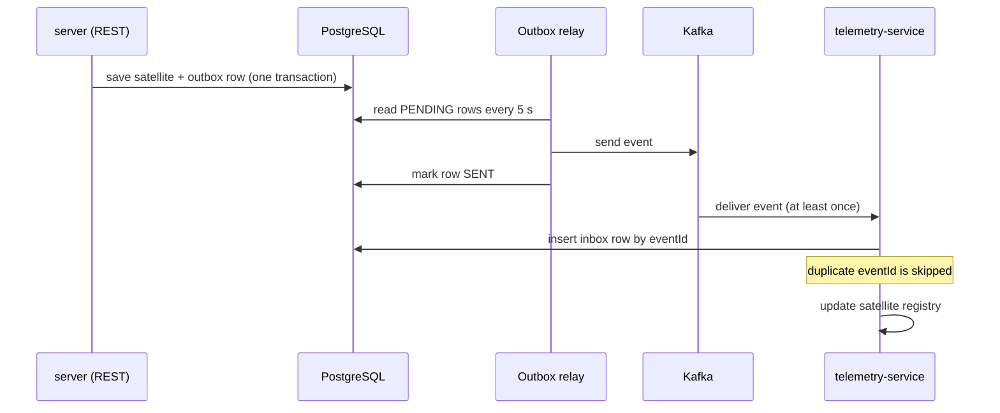

# Seminar 12 — Transactional Outbox and Inbox

| | |
|---|---|
| Branch | `seminar_12` |
| Based on | [`seminar_11_performance_testing`](https://github.com/KardashHleb/satellite-manager/tree/seminar_11_performance_testing) |
| Last commit | 2026-06-09 |
| Next | [`seminar_13`](https://github.com/KardashHleb/satellite-manager/tree/seminar_13) |
| All seminars | [SEMINARS.md on main](https://github.com/KardashHleb/satellite-manager/blob/main/SEMINARS.md) |

## Learning goal

Make event delivery between services **reliable**. Writing to the database and sending to Kafka are two separate
operations; if one succeeds and the other fails, the services disagree. The **Transactional Outbox** and
**Inbox** patterns solve this.

## What was done



- **Outbox (server)**, package `outbox/`:
  - `OutboxEvent` — table `outbox` with a JSONB payload and status `PENDING` / `SENT` (migration `V3__outbox.sql`);
  - `OutboxSatelliteEventPublisher` stores the event **in the same transaction** as the satellite change;
  - `OutboxRelayScheduler` + `OutboxRelayService` poll pending rows (every `app.outbox.poll-interval-ms`,
    batches of 100), send them to Kafka and mark them `SENT`.
  - The direct `KafkaSatelliteEventPublisher` was removed; `@EnableScheduling` added.
- **Event id**: `SatelliteLifecycleEvent` now carries a UUID `eventId`.
- **Inbox (telemetry-service)**: JPA, Flyway and PostgreSQL added; table `inbox` (`V1__inbox.sql`, own Flyway
  history table `flyway_telemetry_schema_history`); `SatelliteLifecycleEventProcessor` records each `eventId` first and
  skips duplicates, including concurrent ones (unique key violation is treated as "already processed").
- Docs: `docs/KAFKA_SATELLITE_EVENTS.md` updated, load-test guide moved to `docs/AdditionalREADME/README-LOAD.md`.

## How to run

```bash
docker compose up --build
```

Create or delete a satellite via Swagger (http://localhost:8082/swagger-ui/index.html); within about 5 seconds it
appears in or disappears from http://localhost:8084/api/telemetry/known-satellites.

## Known issues

- Both services run Flyway against the same database; the second one can fail on a "non-empty schema" at the first
  start. Seminar 13 adds `baseline-on-migrate` and a start order to fix this.
- The relay gives at-least-once delivery; failed rows are retried forever without a retry counter, and sent rows are
  never cleaned up.
- The telemetry registry is in memory, so it is empty after a restart until new events arrive.
- `gradle-wrapper.jar` was missing from Git; **fixed in the commit that added this file**.
