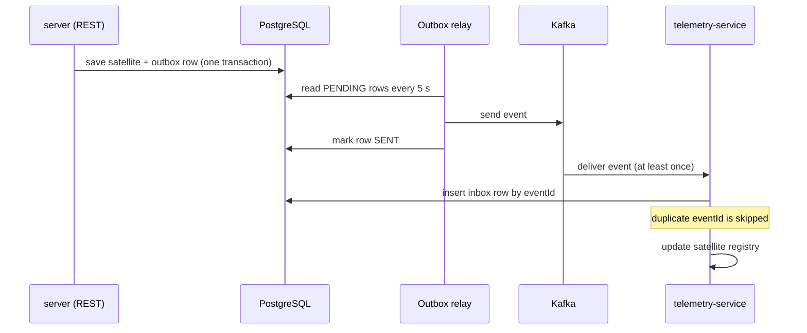

# Seminar 12 — Transactional Outbox and Inbox

| | |
|---|---|
| Branch | `seminar_12` |
| Based on | [`seminar_11_performance_testing`](https://github.com/KardashHleb/satellite-manager/tree/seminar_11_performance_testing) |
| Last commit | 2026-06-09 |
| Next | [`seminar_13`](https://github.com/KardashHleb/satellite-manager/tree/seminar_13) |
| All seminars | [SEMINARS.md on main](https://github.com/KardashHleb/satellite-manager/blob/main/SEMINARS.md) |

## Learning goal

Make event delivery between services **reliable**. Writing to the database and sending to Kafka are two separate
operations; if one succeeds and the other fails, the services disagree. The **Transactional Outbox** and
**Inbox** patterns solve this.

## What was done



- **Outbox (server)**, package `outbox/`:
  - `OutboxEvent` — table `outbox` with a JSONB payload and status `PENDING` / `SENT` (migration `V3__outbox.sql`);
  - `OutboxSatelliteEventPublisher` stores the event **in the same transaction** as the satellite change;
  - `OutboxRelayScheduler` + `OutboxRelayService` poll pending rows (every `app.outbox.poll-interval-ms`,
    batches of 100), send them to Kafka and mark them `SENT`.
  - The direct `KafkaSatelliteEventPublisher` was removed; `@EnableScheduling` added.
- **Event id**: `SatelliteLifecycleEvent` now carries a UUID `eventId`.
- **Inbox (telemetry-service)**: JPA, Flyway and PostgreSQL added; table `inbox` (`V1__inbox.sql`, own Flyway
  history table `flyway_telemetry_schema_history`); `SatelliteLifecycleEventProcessor` records each `eventId` first and
  skips duplicates, including concurrent ones (unique key violation is treated as "already processed").
- Docs: `docs/KAFKA_SATELLITE_EVENTS.md` updated, load-test guide moved to `docs/AdditionalREADME/README-LOAD.md`.

## How to run

```bash
docker compose up --build
```

Create or delete a satellite via Swagger (http://localhost:8082/swagger-ui/index.html); within about 5 seconds it
appears in or disappears from http://localhost:8084/api/telemetry/known-satellites.

## Known issues

- The relay gives at-least-once delivery; failed rows are retried forever without a retry counter, and sent rows are
  never cleaned up.
- The telemetry registry is in memory, so it is empty after a restart until new events arrive.
- A unique key violation on the inbox insert marks the transaction for rollback, so a concurrent duplicate ends with an
  error and a redelivery (which is then skipped as a known `eventId`) rather than a silent skip.
- `server` and `telemetry-service` start in parallel. Making `telemetry-service` wait for a healthy `server` (as in
  seminar 13) is not possible here: the `server` health includes the gRPC channel to `telemetry-service`, which is
  down until `telemetry-service` runs.

## Fixed after the seminar

- `gradle-wrapper.jar` was missing from Git, which broke `./gradlew` and `docker compose up --build` on a fresh
  clone; it was added together with this file.
- Both services run Flyway against the same database with separate history tables; the one that started second failed
  on a "non-empty schema" without a history table. `baseline-on-migrate` (baseline version 0, so all migrations are
  still applied) is now set in both services.
- Operations on satellites loaded in an earlier transaction (activate, deactivate, photo, send data, mission, remove)
  were not saved; they are applied to the managed instance.
- Adding a satellite with a new constellation was not atomic; `SpaceOperationCenterService.addSatellite` is
  transactional. Deleting a constellation or removing a satellite through `ConstellationService` now publishes the
  deleted events (before, the outbox got no row and `telemetry-service` kept the satellites).
- `SpaceOperationController` answered every error with 400 and emoji strings; it now returns 404 for an unknown
  constellation or satellite, 400 for bad input, 500 otherwise, without emojis.
- `Satellite.activate()` on an already active satellite printed "battery level is low", and the console "activate by
  type" counted satellites that failed to activate; it now reports "already active" and counts only real activations.
- The console menu changed send data and photo on detached satellites, so the result was not saved; it now goes
  through the service.
- `bootRun` / `run` did not pass the console input to the menu; `standardInput = System.in` was added.
- Unused copies of `telemetry.proto` in `server` and `telemetry-service` removed, `apache/kafka` image pinned to
  3.9.0, the gRPC server starter in `telemetry-service` aligned with the client version (3.0.0; 2.15.0 targets
  Spring Boot 2).
- Tests: activation of a satellite, operations on the managed instance, deleted events on remove and delete.
- All text (docs, comments, messages, test names) translated to English. The two comments in the Flyway migration `V1__init_schema.sql` are kept in the original language on purpose: editing an applied migration changes its checksum, and Flyway would refuse to start on an existing database.
