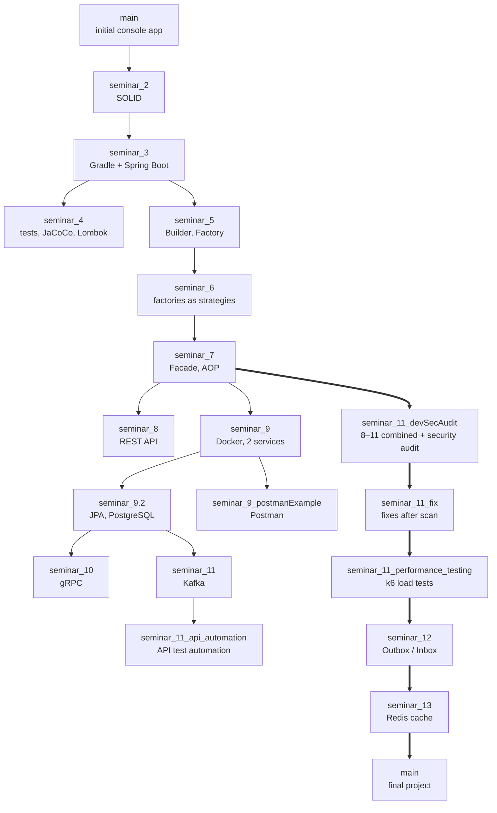

# Seminars: the learning path of Satellite Manager

This project was built step by step during a Java backend course. Every seminar has its **own branch**, so you can
open any branch and see the project exactly as it was at that point. Each branch contains a `SEMINAR.md` file with
the learning goal, what was done, how to run it and known issues.

`main` contains the final state (seminar 13). The main [README](README.md) describes the finished system.

---

## Contents

- [Branch map](#branch-map)
- [Overview](#overview)
- [Part 1. Object-oriented design (seminars 2–7)](#part-1-object-oriented-design-seminars-27)
- [Part 2. Web and microservices (seminars 8–11)](#part-2-web-and-microservices-seminars-811)
- [Part 3. Quality, security and reliability (seminars 11–13)](#part-3-quality-security-and-reliability-seminars-1113)
- [Other branches](#other-branches)
- [How to explore a seminar](#how-to-explore-a-seminar)

---

## Branch map

Arrows show which branch each one was created from. The bold path is the main line that ends in `main`.



`seminar_4` and `seminar_5` share the same testing commit; `seminar_5` continues with patterns.
`seminar_11_devSecAudit` combines the work of seminars 8–11 into one line, and the course continues from there.

---

## Overview

| # | Branch | Topic | What we show |
|---|--------|-------|--------------|
| 2 | [`seminar_2`](https://github.com/KardashHleb/satellite-manager/tree/seminar_2) | SOLID | Extracting `EnergySystem` and `SatelliteState` from `Satellite` (single responsibility) |
| 3 | [`seminar_3`](https://github.com/KardashHleb/satellite-manager/tree/seminar_3) | Build and DI | Gradle, Spring Boot, repository and service layers |
| 4 | [`seminar_4`](https://github.com/KardashHleb/satellite-manager/tree/seminar_4) | Testing | Unit, mock and integration tests, JaCoCo coverage, Lombok |
| 5 | [`seminar_5`](https://github.com/KardashHleb/satellite-manager/tree/seminar_5) | GoF patterns 1 | Builder (`EnergySystem`), Factory Method (satellite factories) |
| 6 | [`seminar_6`](https://github.com/KardashHleb/satellite-manager/tree/seminar_6) | GoF patterns 2 | Parameter objects, factory selected at runtime from all Spring beans |
| 7 | [`seminar_7`](https://github.com/KardashHleb/satellite-manager/tree/seminar_7) | GoF patterns 3 | Facade over the services, execution-time logging with AOP |
| 8 | [`seminar_8`](https://github.com/KardashHleb/satellite-manager/tree/seminar_8) | Spring MVC | REST controller, Swagger UI, browser test page |
| 9 | [`seminar_9`](https://github.com/KardashHleb/satellite-manager/tree/seminar_9) | Microservices | Two services over HTTP, Dockerfiles, Docker Compose |
| 9.2 | [`seminar_9.2`](https://github.com/KardashHleb/satellite-manager/tree/seminar_9.2) | Persistence | JPA inheritance, PostgreSQL, Flyway, full CRUD API |
| 9+ | [`seminar_9_postmanExample`](https://github.com/KardashHleb/satellite-manager/tree/seminar_9_postmanExample) | API testing | Postman test scripts that compare two services' responses |
| 10 | [`seminar_10`](https://github.com/KardashHleb/satellite-manager/tree/seminar_10) | gRPC | Protobuf contract, server-streaming telemetry |
| 11 | [`seminar_11`](https://github.com/KardashHleb/satellite-manager/tree/seminar_11) | Kafka | Satellite lifecycle events, shared contract modules |
| 11+ | [`seminar_11_api_automation`](https://github.com/KardashHleb/satellite-manager/tree/seminar_11_api_automation) | Test automation | Running an external API test suite, fixes it revealed |
| 11 | [`seminar_11_devSecAudit`](https://github.com/KardashHleb/satellite-manager/tree/seminar_11_devSecAudit) | DevSecOps | Gitleaks, Semgrep, SBOM, Grype, OWASP ZAP |
| 11 | [`seminar_11_fix`](https://github.com/KardashHleb/satellite-manager/tree/seminar_11_fix) | Remediation | Dependency update, line-ending fix, re-scan |
| 11 | [`seminar_11_performance_testing`](https://github.com/KardashHleb/satellite-manager/tree/seminar_11_performance_testing) | Load testing | k6 scenario, thresholds, Allure report |
| 12 | [`seminar_12`](https://github.com/KardashHleb/satellite-manager/tree/seminar_12) | Reliable messaging | Transactional Outbox and idempotent Inbox |
| 13 | [`seminar_13`](https://github.com/KardashHleb/satellite-manager/tree/seminar_13) | Caching | Spring Cache with Redis, TTLs, invalidation, graceful degradation |

---

## Part 1. Object-oriented design (seminars 2–7)

A small console application for managing satellite constellations is reshaped with classic design principles.

### Seminar 2 — SOLID
**Goal:** apply the single responsibility principle and encapsulation.
**What we show:** `Satellite` no longer manages its battery and state itself; `EnergySystem` and `SatelliteState`
each own one concern. The repository is cleaned of IDE files and compiled classes.
[Branch](https://github.com/KardashHleb/satellite-manager/tree/seminar_2) ·
[Notes](https://github.com/KardashHleb/satellite-manager/blob/seminar_2/SEMINAR.md)

### Seminar 3 — Gradle, Spring Boot and layers
**Goal:** a real build tool, dependency injection and a layered architecture.
**What we show:** Gradle wrapper, Spring Boot application with a console runner, `@Repository` and `@Service`
layers wired by Spring.
[Branch](https://github.com/KardashHleb/satellite-manager/tree/seminar_3) ·
[Notes](https://github.com/KardashHleb/satellite-manager/blob/seminar_3/SEMINAR.md)

### Seminar 4 — Testing
**Goal:** understand unit, mock and integration tests and measure coverage.
**What we show:** JUnit 5 and Mockito tests for the repository and service, JaCoCo HTML reports, Lombok to
remove getters and constructors.
[Branch](https://github.com/KardashHleb/satellite-manager/tree/seminar_4) ·
[Notes](https://github.com/KardashHleb/satellite-manager/blob/seminar_4/SEMINAR.md)

### Seminar 5 — Builder and Factory Method
**Goal:** creational patterns in a real domain.
**What we show:** a validating `EnergySystem` builder; one factory per satellite type, registered as Spring components.
[Branch](https://github.com/KardashHleb/satellite-manager/tree/seminar_5) ·
[Notes](https://github.com/KardashHleb/satellite-manager/blob/seminar_5/SEMINAR.md)

### Seminar 6 — Extensible creation
**Goal:** add new types without changing existing code (open/closed principle).
**What we show:** `SatelliteParam` parameter objects; `SatelliteServiceImpl` receives all factories from Spring and
picks the one that supports the requested type.
[Branch](https://github.com/KardashHleb/satellite-manager/tree/seminar_6) ·
[Notes](https://github.com/KardashHleb/satellite-manager/blob/seminar_6/SEMINAR.md)

### Seminar 7 — Facade and AOP
**Goal:** a simple entry point to the service layer and cross-cutting concerns without duplication.
**What we show:** `SpaceOperationCenterService` as a facade over `ConstellationService` and `SatelliteService`;
`@LogExecutionTime` annotation with an `@Around` aspect.
[Branch](https://github.com/KardashHleb/satellite-manager/tree/seminar_7) ·
[Notes](https://github.com/KardashHleb/satellite-manager/blob/seminar_7/SEMINAR.md)

---

## Part 2. Web and microservices (seminars 8–11)

The application becomes a web API and is split into services that communicate over HTTP, gRPC and Kafka.

### Seminar 8 — Spring MVC and REST
**Goal:** expose the domain over HTTP.
**What we show:** `SpaceOperationController` with endpoints for constellations, satellites and missions; Swagger UI;
an HTML test page.
[Branch](https://github.com/KardashHleb/satellite-manager/tree/seminar_8) ·
[Notes](https://github.com/KardashHleb/satellite-manager/blob/seminar_8/SEMINAR.md)

### Seminar 9 — Microservices and Docker
**Goal:** run several services together in containers.
**What we show:** multi-module Gradle build, `mission-service` calling `server` over HTTP, multi-stage Dockerfiles
with non-root users, Docker Compose with health checks.
[Branch](https://github.com/KardashHleb/satellite-manager/tree/seminar_9) ·
[Notes](https://github.com/KardashHleb/satellite-manager/blob/seminar_9/SEMINAR.md)

### Seminar 9.2 — Database
**Goal:** persistent storage with a managed schema.
**What we show:** JPA entities with `JOINED` inheritance, Spring Data repositories, Flyway migrations, PostgreSQL in
Compose, CRUD endpoints, `@DataJpaTest` tests, and a short study of `@Embedded` vs `@OneToOne`.
[Branch](https://github.com/KardashHleb/satellite-manager/tree/seminar_9.2) ·
[Notes](https://github.com/KardashHleb/satellite-manager/blob/seminar_9.2/SEMINAR.md)

### Seminar 9 (extra) — Postman
**Goal:** automated checks of an API in Postman.
**What we show:** test scripts that assert status and body and verify that the gateway returns exactly what the server returns.
[Branch](https://github.com/KardashHleb/satellite-manager/tree/seminar_9_postmanExample) ·
[Notes](https://github.com/KardashHleb/satellite-manager/blob/seminar_9_postmanExample/SEMINAR.md)

### Seminar 10 — gRPC
**Goal:** contract-first communication and streaming.
**What we show:** `telemetry.proto`, a new `telemetry-service` that streams temperatures, and a client in `server`
that reconnects and stores the data.
[Branch](https://github.com/KardashHleb/satellite-manager/tree/seminar_10) ·
[Notes](https://github.com/KardashHleb/satellite-manager/blob/seminar_10/SEMINAR.md)

### Seminar 11 — Kafka
**Goal:** asynchronous, decoupled communication.
**What we show:** `satellite.created` / `satellite.deleted` events from `server`, a Kafka listener in
`telemetry-service` that keeps the list of satellites to stream, shared `telemetry-proto` and `satellite-events` modules.
[Branch](https://github.com/KardashHleb/satellite-manager/tree/seminar_11) ·
[Notes](https://github.com/KardashHleb/satellite-manager/blob/seminar_11/SEMINAR.md)

### Seminar 11 (extra) — API test automation
**Goal:** test the running system from an external automated suite.
**What we show:** how to run the separate api-automation project with Allure, and the fixes it revealed (real ids in events).
[Branch](https://github.com/KardashHleb/satellite-manager/tree/seminar_11_api_automation) ·
[Notes](https://github.com/KardashHleb/satellite-manager/blob/seminar_11_api_automation/SEMINAR.md)

---

## Part 3. Quality, security and reliability (seminars 11–13)

The final line of the project starts from `seminar_11_devSecAudit`, which combines all of the web and microservice
work, and ends in `main`.

### Seminar 11 — Security audit
**Goal:** find security problems with standard DevSecOps tools.
**What we show:** Gitleaks (secrets), Semgrep (static analysis), Syft (SBOM), Grype (vulnerable dependencies),
OWASP ZAP (dynamic scan) with committed reports and a how-to guide.
[Branch](https://github.com/KardashHleb/satellite-manager/tree/seminar_11_devSecAudit) ·
[Notes](https://github.com/KardashHleb/satellite-manager/blob/seminar_11_devSecAudit/SEMINAR.md)

### Seminar 11 — Fixes after the audit
**Goal:** remediate and verify.
**What we show:** Spring Boot update to 3.4.13, LF line endings for `gradlew` so containers build on Windows
checkouts, a second scan.
[Branch](https://github.com/KardashHleb/satellite-manager/tree/seminar_11_fix) ·
[Notes](https://github.com/KardashHleb/satellite-manager/blob/seminar_11_fix/SEMINAR.md)

### Seminar 11 — Load testing
**Goal:** measure behavior under load with clear pass/fail criteria.
**What we show:** a k6 user-flow scenario with smoke and load profiles, latency and error-rate thresholds, results in Allure.
[Branch](https://github.com/KardashHleb/satellite-manager/tree/seminar_11_performance_testing) ·
[Notes](https://github.com/KardashHleb/satellite-manager/blob/seminar_11_performance_testing/SEMINAR.md)

### Seminar 12 — Outbox and Inbox
**Goal:** no lost and no duplicated events between services.
**What we show:** the event is stored in an `outbox` table in the same transaction as the data and relayed to
Kafka by a scheduler; the consumer records every `eventId` in an `inbox` table and skips duplicates.
[Branch](https://github.com/KardashHleb/satellite-manager/tree/seminar_12) ·
[Notes](https://github.com/KardashHleb/satellite-manager/blob/seminar_12/SEMINAR.md)

### Seminar 13 — Redis cache
**Goal:** faster reads with a distributed cache.
**What we show:** Spring Cache backed by Redis with per-cache TTLs, eviction on writes, cache metrics in Actuator, and
an application that keeps working when Redis is unavailable.
[Branch](https://github.com/KardashHleb/satellite-manager/tree/seminar_13) ·
[Notes](https://github.com/KardashHleb/satellite-manager/blob/seminar_13/SEMINAR.md)

---

## Other branches

| Branch | Purpose |
|--------|---------|
| [`feature/add-menu-options`](https://github.com/KardashHleb/satellite-manager/tree/feature/add-menu-options) | A practice branch for opening a first pull request (adds one comment line); no seminar content |

---

## How to explore a seminar

```bash
git clone https://github.com/KardashHleb/satellite-manager.git
cd satellite-manager
git switch seminar_9.2        # any branch from the table
cat SEMINAR.md                # what this seminar is about and how to run it
```

To see exactly what a seminar changed, compare it with the branch it was created from:

```bash
git diff seminar_9..seminar_9.2 --stat
```

Seminars 3–13 use the Gradle wrapper and Java 21; seminars 9 and later are easiest to start with
`docker compose up --build`.
